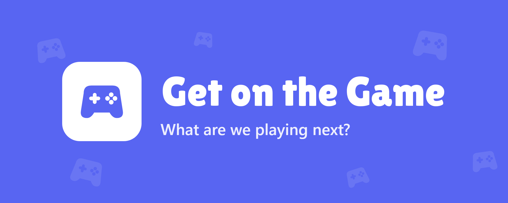

<p align="center"></p>

<h1 align="center">Game Catalog bot</h1>

<p align="center"><b>Never lose another "we should play this!" link again.</b><br>
Your friends post games in Discord. The bot turns them into one catalog everyone can browse, vote on and launch, right inside Discord.</p>

---

## Why your server needs it

- **Just post a link.** Steam, Battle.net or an Instagram reel. The bot fills in price, reviews, tags and co-op modes for you.
- **See what everyone wants.** One click says "I want to play this", and the most wanted games rise to the top.
- **Can't decide?** `/random` picks tonight's game, favoring what most of you want.
- **Get the squad together.** "Ping to play" calls everyone who wants that game in one click.
- **Never miss a deal.** Free-to-keep Steam games and 70%+ sales on your list are posted automatically.
- **Earn achievements** for adding games, playing together and more (some are secret).
- **Only games you can play together.** Singleplayer and couch-only games are turned away, so the list stays useful.

## Up and running in 10 minutes

For now the bot is invite-only: setting it up yourself is for invited collaborators (see [License](#license)). You need Python 3.12 or newer.

1. **Create a bot** in the [Discord Developer Portal](https://discord.com/developers/applications) and add it to your server ([step-by-step](docs/GUIDE.md#1-create-the-bot-on-discord)).
2. **Install it:**
   ```bash
   git clone https://github.com/madsbogaming/mads-bo-wacky.git
   cd mads-bo-wacky
   py -m venv .venv
   .venv\Scripts\pip install -r requirements.txt
   copy .env.example .env
   ```
3. **Fill in `.env`:** your bot token, server ID and games channel. Everything else is optional.
4. **Start it** with `.venv\Scripts\python bot.py`, then run `/backfill` in your games channel to import everything already posted.

That's it. Post a Steam link and watch it land in the catalog.

**More servers?** Invite the same bot to them. Each one gets its own catalog, votes and achievements, and starts with nothing watched: an admin there runs `/setup watch` in its games channel, then `/backfill`, and `/setup country` and `/setup timezone` for prices in their currency and posts at their time. `/setup show` lists what the bot uses on a server.

## Everyone can use

| Command | What it does |
|---|---|
| `/catalog` | Opens the full catalog inside Discord: search, filter, vote and ping friends. |
| `/random` | Picks a game for tonight. Don't like it? Reroll. |
| `/link` | Tells the bot which game an Instagram reel is about. |

Admins get more commands to add, tag, refresh and remove games, and `/setup` to pick the channels the bot uses on their server.

## Want more?

The **[full guide](docs/GUIDE.md)** covers every feature and command, the in-Discord catalog Activity, Steam playtime tracking, and keeping the bot online 24/7.

## Privacy and terms

What the bot keeps about people and why is in the **[privacy policy](docs/PRIVACY.md)**. The rules for using it are in the **[terms of service](docs/TERMS.md)**.

## Help make it better

Found a bug or have an idea? [Open an issue](https://github.com/madsbogaming/mads-bo-wacky/issues/new/choose). Want to change the code? Start with **[CONTRIBUTING.md](CONTRIBUTING.md)**.

## License

The bot is **source-available, not open source.** You may read the code and run a copy on a private test server to develop contributions. Invited collaborators may also run it for their own server. You may not host your own copy for others or reuse the code elsewhere without written permission. See [LICENSE](LICENSE), and [THIRD_PARTY_NOTICES.md](THIRD_PARTY_NOTICES.md) for the parts made by others.
